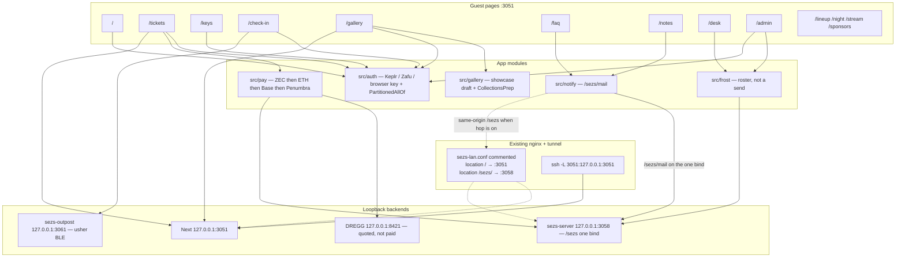

# SEZS Speakeasy guest app

Loopback Next.js 13 (`output: 'export'`) at `127.0.0.1:3051`. An optional SSH local-forward of port 3051 to that loopback address can be used when browsing from another machine. Existing nginx `sezs-lan.conf` is fully commented (old `0.0.0.0:3050`). No second proxy. No mainnet txs from this app.

Area diagrams:

- [Sign-in / secrets](src/auth/ARCHITECTURE.md)
- [Tickets / pay](src/pay/ARCHITECTURE.md)
- [Admin FROST](src/frost/ARCHITECTURE.md)
- [Gallery / showcase](src/gallery/ARCHITECTURE.md)
- Mail: in-process on `sezs-server` when `SEZS_EMAIL_ENABLE=1` (file sink, 4 KiB cap)

Tickets are pre-arrival. Cash App QR is door + Admin. Gallery Buy is off. Mail is a file sink on the one bind when enabled. FROST desk flags are not a send.
