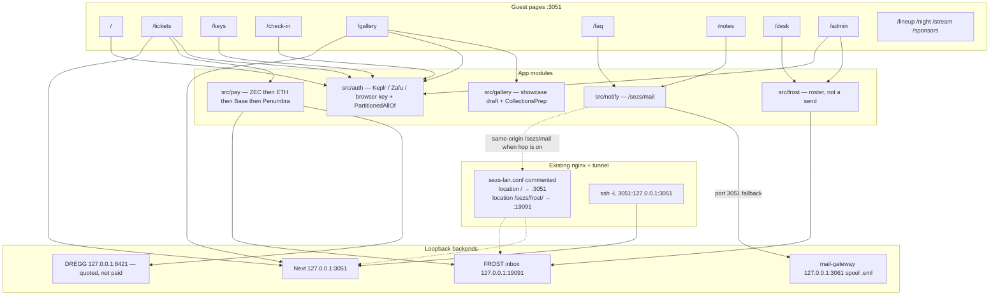

# SEZS Speakeasy guest app

Loopback Next.js 13 (`output: 'export'`) at `127.0.0.1:3051`. Tunnel: `ssh -L 3051:127.0.0.1:3051 build-host`. Existing nginx `sezs-lan.conf` is fully commented (old `0.0.0.0:3050`). No second proxy. No mainnet txs from this app.

Area diagrams:

- [Sign-in / secrets](src/auth/ARCHITECTURE.md)
- [Tickets / pay](src/pay/ARCHITECTURE.md)
- [Admin FROST](src/frost/ARCHITECTURE.md)
- [Gallery / showcase](src/gallery/ARCHITECTURE.md)
- Mail gateway: `<repo>/e2e/lab/sezs/sezs-docs/EMAIL.md`

Tickets are pre-arrival. Cash App QR is door + Admin. Gallery Buy is off. Mail is spool only. FROST desk flags are not a send.
