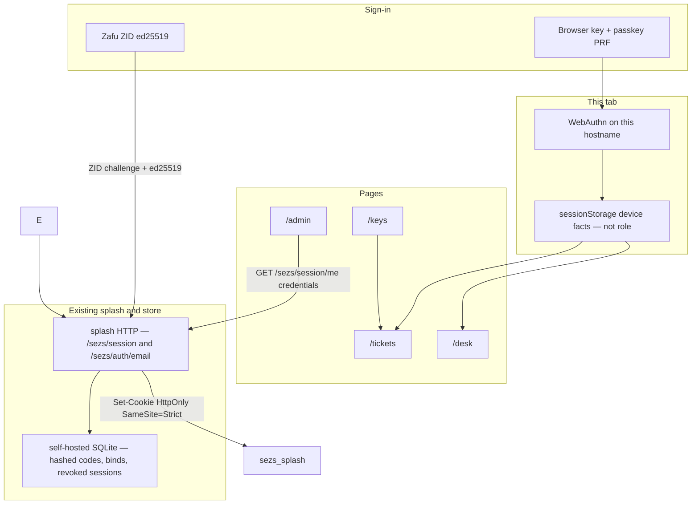

# SEZS secrets + sign-in

Sign-in on this branch is **Zafu ZID** (site-scoped ed25519 via `@zafu/zid`) or a **browser secp256k1 key sealed to a passkey PRF** (fail closed if PRF is unavailable). A passkey alone is not sign-in. Sign-in is not paid. Keplr is not a login option.

An email front end is present in the sign-in modal, but the self-hosted runtime is not on this branch. It lives on `sezs/email-auth-runtime`. See `docs/ZAFU-ZID-LOGIN.md` and `docs/specs/EMAIL-AUTH-GAP.md`.

Shared cellar passwords are gone. The desk does not take a password.

Static Next (`output: 'export'`) cannot `Set-Cookie`. The HttpOnly session cookie is issued by the **existing HashMerchant frost inbox** on `127.0.0.1:19091` after an ADR-036 wallet signature. Not the mail gateway. Not a second proxy.

```mermaid
sequenceDiagram
  actor Person
  participant Tickets as /tickets
  participant Splash as splash
  participant Store as SQLite

  alt Zafu ZID
    Person->>Tickets: Log in with Zafu
    Tickets->>Splash: POST /sezs/session/challenge
    Splash-->>Tickets: origin-bound nonce
    Tickets->>Tickets: @zafu/zid sign(challengeHex)
    Tickets->>Splash: POST /sezs/session/verify
    Splash-->>Tickets: Set-Cookie
  else passkey + browser key
    Person->>Tickets: passkey assertion, UV required
    Note over Tickets: PRF unwraps the sealed browser key. Fail closed if PRF is missing.
  else email
    Person->>Tickets: request a code or open the link
    Tickets->>Splash: POST /sezs/auth/email/request
    Splash->>Store: hashed challenge
    Person->>Tickets: verify OTP or landing ?email_code=
    Tickets->>Splash: POST /sezs/auth/email/verify
    Splash->>Store: burn challenge, write session
    Splash-->>Tickets: Set-Cookie
  end

  Person->>Tickets: GET /sezs/session/me
  Splash-->>Tickets: role from bound identity, not from email alone
```

Staff rights still come from a bound `ed25519/zid`, `p256/passkey`, or `terp-bech32`. Email alone stays guest. Nginx rate limits live in the single existing nginx include `apps/sezs/nginx/sezs-email-auth.inc`. Optional proof-of-work can precede `/request`.

## What is still not a server

| Surface | Fact |
| --- | --- |
| Cookie | Issued after a verified ZID (or leftover ADR-36) signature, or a verified email challenge. Browser-key tabs have no ADR-36 here (the key stays sealed). Splash or email-auth down ⇒ role stays guest. |
| Admin allowlist | `SEZS_ADMIN_CREDS` / `SEZS_USHER_CREDS` on the splash process. Unset ⇒ nobody is admin. `NEXT_PUBLIC_*` is not read. |
| nginx | Email-auth include is opt-in in the single existing nginx. Do not add a second proxy. |
| CSP nonce | Not applied. Would need a body rewrite of Next scripts. |
| Email unbind | Binding exists. Unbind and secondary-factor rotation are still open. |
