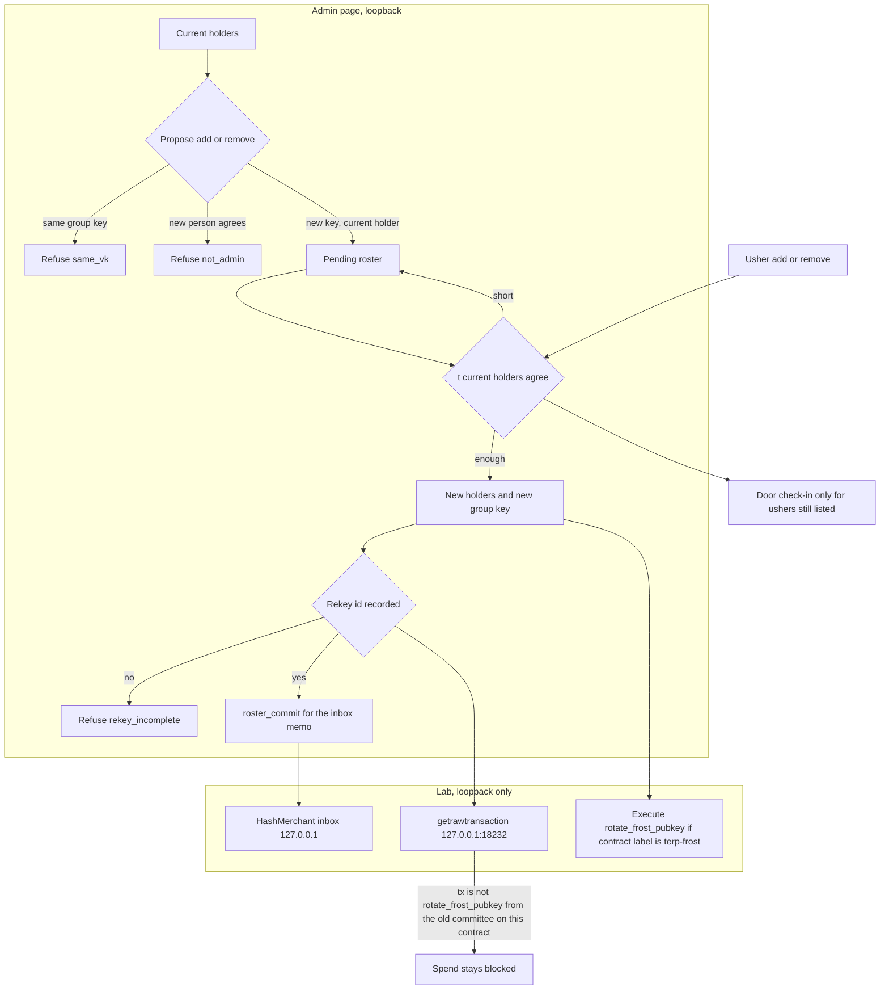
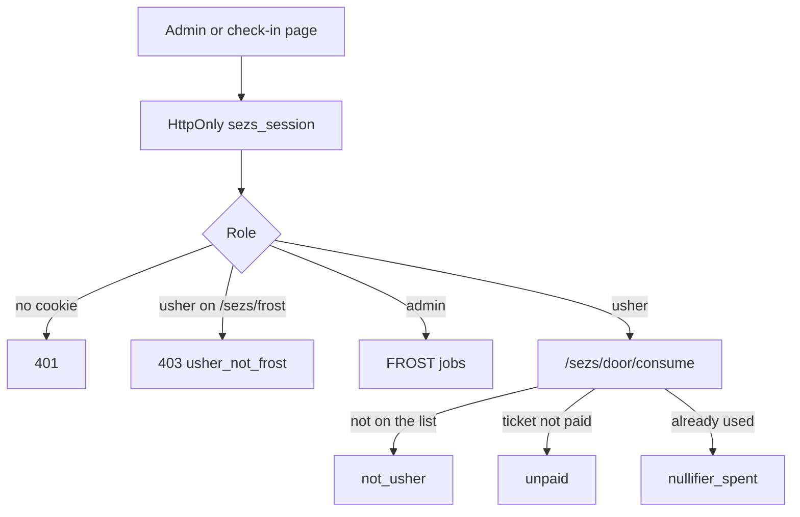

# Admin FROST — holders

The event page does not pay artists. Admin changes who may agree to a payout. Cash App stays on the door QR. Nothing on this page is a mainnet transaction.

Also refuse: `morocco-1`, a cross-site Origin, a claimed admin role, a replayed agreement, and a rekey id the local node does not have.

## What this page refuses

| Attempt | Result |
| --- | --- |
| Add or remove without a new group key | `same_vk` |
| Person being added agrees to their own addition | `not_admin` |
| One holder agrees and the roster already changes | stays pending |
| Remove so many holders that t no longer fits | `bad_threshold` |
| Reuse an agreement from an earlier change | `share_replay_epoch` |
| Spend after the key changes, before rekey | `rekey_incomplete` |
| Key package, mnemonic, or share bytes | not accepted; `keypackage_rejected` |
| Ticket marked paid from this page | not offered |
| Cash App checkout | door QR on Admin and Door only |
| Chain id morocco-1 | `mainnet_refused` |
| Cross-site POST | refused without this origin |
| Claimed admin role | ignored; cred must already be an admin |

Chain authority remains the lab contract `rotate_frost_pubkey` (Execute, not Authenticate). The inbox still requires `roster_commit` in `sezs-frost-memo-v1:`. A commit from the previous holder set is `roster_stale`.

## Load

The holder rules run in the browser with no extra request. The inbox call, when used, is the existing loopback rewrite to `127.0.0.1:19091`. This page does not add a proxy. The dev server is `next dev` on `127.0.0.1:3051`. Admin HTML is small; do not cache it as if a holder change had been finalized.

## Session and door

