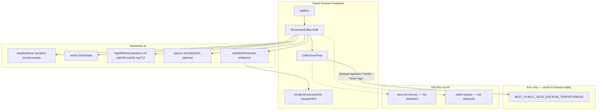

# Gallery / artist showcase (R4)

Spec: `GALLERY-ESCROW-SPEC-2026-10-12.md` (TIER 1, not deployed). Profile fields live in `showcase.ts`. Drafts stay in page state. Escrow-svc and Zafu Nym/SOCKS are other panes.

## Architecture

Invite fragment `#v&i&B&o&x&s` stays in the URL hash so nginx never sees it. Charity split 11.1% + 11.1% + 77.8% is page copy. Buy is off.

## Security / pen-test (this area)

| Check | Result |
| --- | --- |
| Invite secret in fragment | `parseInviteFragment` reads `#…` only. |
| Social hrefs | `URL` parse; `https:` only; no userinfo; refuse `javascript:`, `data:`, `http:`. |
| Synopsis XSS | Stored as text. `escapeHtml` + `renderShowcaseHtml`. Editor has no `dangerouslySetInnerHTML`. |
| Size | Name 80, synopsis 500, href 2048, work about 500. |
| Listed works | `listed: true` is a validation error until escrow exists. |
| Escrow addresses | Env only. Sign disabled when unset. |
| Collection detect | `credentials: 'omit'`. Read-only. |
| Secrets | No keys, mnemonics, tokens, or `.env` values printed. `u.password` is URL userinfo refusal. |
| Mocks | Catalog `GALLERY` may be empty. No fake escrow. |
| Dev cache / load | HTML `Cache-Control: no-store, must-revalidate`. gzip when `Accept-Encoding`. Warm TTFB ~8–11 ms on `/gallery`. |

## Still not real

Registry, invite DHKE, escrow contract, charity picker, ZEC watcher, receipt token, 72-hour release.
