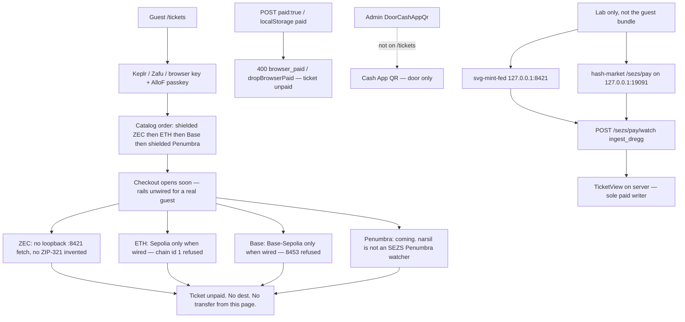

# Tickets payment architecture (overnight R3)

Pre-arrival checkout lives on `/tickets`. Door pay lives on Admin. Bound ≠ paid.
Paid is a **server watcher fact**. The guest browser does not fetch lab loopback.

## Rails

| Rail | Guest instruct | Commit | Network |
| --- | --- | --- | --- |
| shielded ZEC | not live — checkout opens soon | server `ingest_dregg` only | refuse `u1` mainnet UA; lab `utest1` / `uregtest1` |
| ETH | not live — checkout opens soon | same watcher | Sepolia `11155111` only; refuse chain id 1 |
| Base | not live — checkout opens soon | same watcher | Base-Sepolia `84532` only; refuse 8453 |
| shielded Penumbra | not live — coming | none | narsil is a ZEC syndicate scanner, not an SEZS Penumbra watcher |
| Cash App | not on `/tickets` | door / Admin only | — |

A Pay click, a URI, a dest, a passkey, and a browser `paid` flag are not paid.

Guest JS must not call `127.0.0.1:8421` or `127.0.0.1:19091`. A visitor's browser would hit **their** loopback, not build-host. Dev binds `127.0.0.1` only, reached on-box or via SSH port-forward. This pane does not start cloudflared, nginx, or a second proxy.

When rails are wired later, DREGG is `svg-mint-fed` on `127.0.0.1:8421` and `/sezs/pay` shares the existing frost inbox on `127.0.0.1:19091`. Paid still only from a server watcher fact (`Deposited` / `Entitled` / `Settled`).

## Fund a REGTEST / testnet DREGG minter

The fed on build-host is **unfunded**: `/health` has shown `minter_funded: false` with `minter_balance_unknown` (or `minter_underfunded`). Checkout stays closed until you fund the **already-configured lab minter**. This pane will not read `.env`, will not print keys, and will not send mainnet.

**Provide, yourself, on build-host (REGTEST or Terp testnet only):**

1. **The lab Terp the fed already uses.** Same chain the existing `DREGG_MINTER_LCD` / local terpd already points at. Confirm it is REGTEST or a Terp testnet — not morocco-1 / mainnet. Do not paste the LCD URL.

2. **The minter `terp1…` already stored as `DREGG_MINTER_ADDR`.** Do not create a new minter. Do not send a mnemonic, keyring password, or spending key. This pane will not open `~/.terp/dregg-svg.env`. Quote the address only if you already know it.

3. **A native-denom send to that minter, on that lab chain.** Denom is `GAS_DENOM` (DREGG default `uthiol`, 6 decimals). Cover at least one first-rail BOGO pair plus gas:
   - `100_000_000` smallest units × 2 NFTs + `50_000_000` gas reserve (`DREGG_MINTER_GAS_RESERVE` default) = **`250_000_000` smallest units** (250 display units at 6 decimals).
   - Send more if you want several mints of headroom. Under this floor, `/health` stays `minter_underfunded`.

4. **How the fed is allowed to see the balance** (pick one; lab only; no secrets in chat):
   - **Preferred:** loopback LCD already set (`DREGG_MINTER_LCD`, typically `http://127.0.0.1:1317`). After the bank send, `GET /cosmos/bank/v1beta1/balances/{minter}` must return the denom. `/health` re-queries; do not set a fake funded flag.
   - **Only if LCD is unset:** a numeric `DREGG_MINTER_BALANCE` in smallest units. Do **not** set `DREGG_MINTER_FUNDED=1` — that is not live proof. If LCD is set, a failed LCD query is `minter_balance_unknown` and the balance override is ignored.

5. **Do not provide:** mnemonics, `DREGG_HD_SEED`, `SVG_MINT_FED_SK_HEX`, ZEC spending keys, Zallet/zcli passwords, or any mainnet uterp / TERP.

**Proof that funding worked** (on-box or SSH port-forward, never a public tunnel from this pane): `GET http://127.0.0.1:8421/health` shows `minter_funded: true`, `checkout_ready: true`, and empty `reasons`.

A live shielded-ZEC ticket still also needs, separately, a funded testnet/regtest ZEC spend capability already on build-host (zcli/Zallet — never a mnemonic) and a CompactTxStreamer on `127.0.0.1:19067` that this pane must not steal from artmint-lwd. Lab `DREGG_ZEC_UA` must already be `utest1` / `uregtest1` (do not print it).
