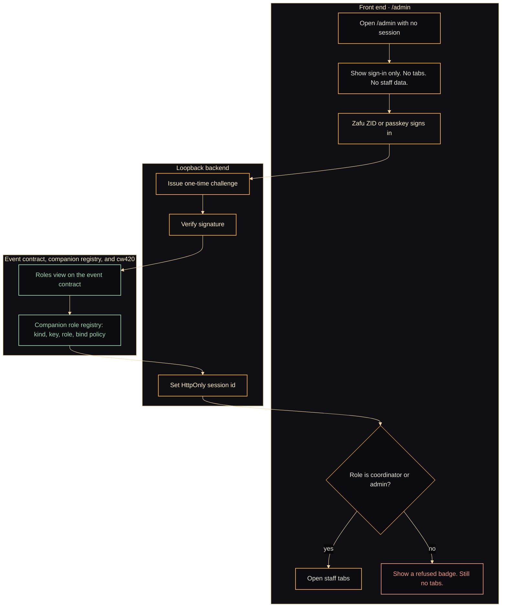
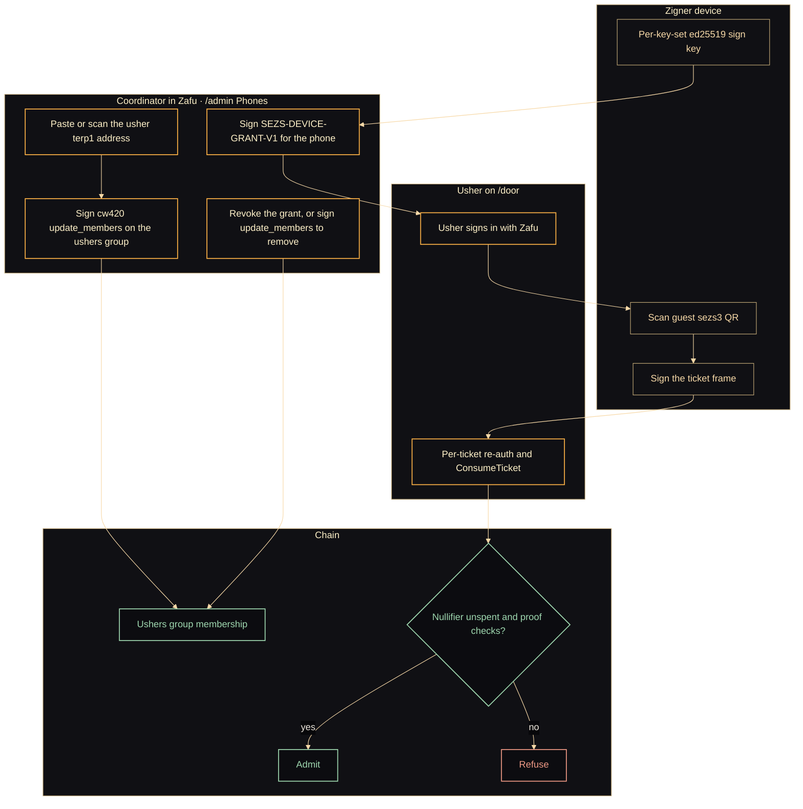

# Identity and roles

Status: draft. This document is the specification for how event coordinators
and ushers connect to the front end, and how identity binds to a role.

Language in this document follows a small ASD-STE100-like subset: short
sentences, active voice, one action in each procedural sentence. Mermaid
diagrams follow the Trail of Bits / Trailmark product-flow conventions used
in `docs/specs/diagrams/` and `docs/flows/`.

This document describes current on-chain types in this repository and a
proposed contract change. Do not deploy a contract change until the user
agrees.

## 1. Identity kinds

Each identity kind is distinct. Do not treat one kind as a substitute for
another.

| Kind | Curve / type | Public form | Typical holder | Proof of control |
| --- | --- | --- | --- | --- |
| `terp-bech32` | secp256k1 | bech32 `terp1…` account address | Zafu Terp account (`sezs1…` on the local chain). Keplr is not a sign-in option. | ADR-36 `signArbitrary`, or a signed CosmWasm execute, for on-chain staff txs only |
| `ed25519/zid` | ed25519 | site-scoped Zafu ZID public key | Zafu ZID for this origin | ed25519 signature over a domain-separated login challenge |
| `p256/passkey` | WebAuthn P-256 | passkey credential public key | Zafu native passkey account, or a browser passkey | WebAuthn assertion for this origin and `rpId` |
| `penumbra` | Penumbra account | Penumbra address | Payment identity | Out of scope for event-role execute today |
| `zcash` | Zcash account | Zcash address (transparent or unified, as the payment path uses) | Payment identity | Out of scope for event-role execute today |
| `zigner-device-ed25519` | ed25519 | device public key | Zigner usher device, one key per selected key set | Device grant plus a per-ticket signed frame (see below) |

The Zigner usher device sign key is not the bech32 Terp address that a key
set may also derive. The sign key is unique to the selected key set. The
key is derived deterministically from that set. The derivation path is
documented in the Zigner worktree file
`docs/sezs-usher-ble-camera.md` (worktree `zigner-usher-ble-camera` on
`sezs/usher-ble-camera`). Do not use the main Zigner checkout as the source
for this path.

A person may hold more than one identifier. A person may use a Terp
account, a ZID, a passkey, and payment accounts together.

Zafu's default ZID is site-scoped, not event-scoped and not
account-scoped. The same origin therefore reuses one ZID across events
on that origin. See §1.1. Zigner device sign keys can still be unique
per selected key set (per-index keys).

## 1.1 ZID scoping, as implemented in Zafu

Verified in the Zafu source (worktree `_worktrees/zafu`, package
`packages/zid` and extension `apps/extension/src/state/identity.ts`),
not in the Zigner checkout.

The default identity is `deriveZidForSite(mnemonic, identity, origin,
rotation = 0)`. The comment on that function states that this is the
default mode and that each site sees a unique key. The origin is the
site origin the browser attests (for example `https://event.example`).
It is not an event id and it is not a payment-account id. The
`identity` argument is a named identity inside the wallet (the default
name is `default`), not a Terp, Penumbra, or Zcash account.

Consequence for SEZS: two events that share one front-end origin see
the same ZID. The default is to reuse that origin ZID across events,
not to mint a fresh ZID per event. A later event on the same origin
should look up the same `ed25519/zid` key.

Keys are unlinkable across origins. A dapp on origin A cannot correlate
the ZID it sees with the ZID on origin B. Contact handles are also
origin-scoped (`BLAKE2b(pubkey || app_origin || "zid:contact:v1")`,
described as deterministic per contact and app, unlinkable across
apps). Display names are stored per app for the same reason. Guest
(ephemeral) ZIDs also derive distinct keys per origin.

`deriveZidCrossSite` exists as an opt-in only. That key is the same
across origins for one named identity. The Zafu source warns that
sharing it lets sites collude to link sessions. Do not use the
cross-site key as the SEZS default.

A site ZID also has a rotation index and a separate X25519
key-agreement seed for that origin. Those are still site-scoped.

Zigner usher device keys are a different kind (`zigner-device-ed25519`).
They stay unique per selected key set (per-index), as §1 already
records. That path is independent of ZID origin reuse.

## 2. Roles today

The event contract (`cw-event-manifold`) returns a `Roles` view:

- `curators`: contract admin / curator addresses (`Vec<String>` of bech32
  `Addr`).
- `coordinators`: members of the coordinators cw420 group.
- `coordinators_group`: that group contract address.
- `ushers`: members of the optional ushers cw420 group.
- `usher_group`: that group contract address, if set.
- `service_key`: optional backend runtime key. This key is not a human
  coordinator.

cw420 (`contracts/cw-ave/contracts/cw420`) is a cw4 group. Membership is
`cw4::Member { addr: String, weight: u64 }`. The state map is
`SnapshotMap<&Addr, u64>`. The admin is a single `Addr`. Execute messages
are `UpdateAdmin`, `UpdateMembers { add, remove }`, `AddHook`, and
`RemoveHook`. Hooks notify after a membership change. Hooks do not grant
execute rights.

Consequence: cw420 can store only a CosmWasm `Addr` (a Terp bech32 account
today). It cannot store a raw ed25519 ZID, a P-256 passkey public key, or a
Zigner device key.

The event contract uses those groups as follows:

- A coordinator (group member or curator) may change event configuration,
  including `SetUsherGroup` and `SetCoordinators`.
- An usher group member may `ConsumeTicket`.
- There is no `AddUsher` execute on the event contract. A coordinator adds
  or removes an usher with cw420 `UpdateMembers`, signed in the coordinator
  wallet. The backend does not hold the group-admin key and does not execute
  that message.

Front-end staff roles in `apps/sezs/src/auth/roles.mjs` are `admin`,
`coordinator`, `frost_admin`, `usher`, and `guest`. Payroll and participants
require an event-admin role. The door and usher chat also allow an usher.

The admin FROST set (guest-root publish) is a 2-of-n signing set. It is not
a cw420 member list. Public metadata is `{ t, n, verifyingKey }`. Share
material stays off the front end.

## 3. How a role entry is verified, per kind

Verification always checks a current role entry for this event. A leftover
cookie or a local claim is not enough when a live chain query is configured.

### `terp-bech32`

1. The wallet signs a domain-separated challenge with ADR-36, or it signs a
   CosmWasm execute.
2. The backend verifies the ADR-36 signature against the bech32 address.
3. The backend reads `Roles` (and the cw420 group if needed) on the local
   LCD.
4. If the address is a curator or a coordinator member, the session role is
   coordinator (or admin, when that distinction is still recorded).
5. If the address is an usher member only, the session role is usher.

### `ed25519/zid`

1. The wallet signs the same class of login challenge with the site-scoped
   ZID.
2. The backend verifies the ed25519 signature against the ZID public key
   and the event origin (`domain` on the event contract).
3. The backend looks up a role entry of kind `ed25519/zid` for this event
   (proposed registry below). Today this kind has no on-chain role slot.

### `p256/passkey`

1. The authenticator returns a WebAuthn assertion for this origin and
   `rpId`.
2. The backend verifies the assertion against the registered P-256 public
   key.
3. The backend looks up a role entry of kind `p256/passkey` in the companion
   role registry for this event (proposed below). Today a passkey can
   complete a browser sign-in, but it does not appear in cw420 membership.

### `zigner-device-ed25519`

1. A coordinator who already proved control issues a device grant
   (`SEZS-DEVICE-GRANT-V1`) and signs it with ADR-36.
2. The grant names the device public key and the usher Terp address.
3. For each ticket, the device signs a frame (`SEZS-TICKET-FRAME-V1`).
4. The usher authorizes consume (`SEZS-CONSUME-V3-DEVICE`) and signs the
   `ConsumeTicket` execute in Zafu.
5. Revoke the grant to stop the device. On-chain usher membership is
   separate: a coordinator signs `UpdateMembers` to remove the usher
   address.

### `penumbra` and `zcash`

These identifiers are payment accounts only. They do not enter the role
registry. They do not open `/admin` and they do not authorize
`ConsumeTicket`. There is no use case for a role entry of either kind.

## 4. Wallet login session

The front end already distinguishes a finished sign-in (`signInComplete`)
from a passkey that is only on the device. A finished sign-in on this
branch is a Zafu ZID or a passkey plus a sealed browser key. Keplr is not
a sign-in option. An email front end exists in the modal, but email
sessions are not served until `sezs/email-auth-runtime` merges.

The session that authorizes staff data must also prove control of a staff
identifier:

1. The front end opens the sign-in modal.
2. The person selects Zafu (ZID), Zafu passkey, or this browser.
3. For Zafu ZID, the front end requests a one-time origin-bound challenge
   (`SEZS-LOGIN-ZID-V1`).
4. Zafu signs the ZID challenge with `@zafu/zid`. A passkey unwraps the
   sealed browser key (fail closed if PRF is missing).
5. The backend verifies the proof, reads on-chain roles when a bound
   chain identity exists, and sets an HttpOnly `sezs_splash` cookie.
   The cookie does not hold the address.
6. Later staff requests send that cookie. The backend reads the session and
   checks the live role again when a local LCD is configured.

A signed-in guest who is not on the coordinator or usher set receives a
guest session. That person must not see `/admin` tabs or staff data.



## 5. Usher onboarding, grant, re-auth, and revocation



Membership on the ushers group and a device grant are two layers. A grant
without membership cannot consume. Membership without a grant cannot use
that phone. Revoke the layer that must stop.

## 6. Proposed contract change

Do not extend cw420 so that `Member.addr` holds a raw public key. The
map is an `Addr`. A non-address identifier would break CosmWasm address
validation and group-weighted execute checks.

The typed role registry is a modular companion contract. It is not a
module of `cw-event-manifold`. The event contract holds a reference to
one registry address. One registry instance serves one event. The same
code can instantiate a registry for another event.

cw-event-manifold gains only:

- Config field `role_registry: Option<Addr>`.
- Execute `SetRoleRegistry { registry }` (curator or current contract
  admin).
- Query `RoleRegistry {}` → the companion address, if set.

The companion stores entries and policy. The event contract does not
store role entries.

### 6.1 Registry config (admin policy)

The event admin configures the registry per event. The admin chooses
which identity kinds this event accepts, and whether a kind must bind a
Terp address to hold a role.

```
IdentityKind = terp-bech32 | ed25519/zid | p256/passkey
             | zigner-device-ed25519

BindRule = {
  kind: IdentityKind,
  require_bound_terp: bool
}

RegistryConfig = {
  admin: Addr,                 // curator / event admin
  event: Addr,                 // cw-event-manifold for this event
  allowed_kinds: IdentityKind[],
  bind_rules: BindRule[]
}
```

A kind that is not in `allowed_kinds` is refused on `AddRoleEntry`.

`require_bound_terp` is the policy for that kind. Typical defaults, which
the admin may change:

- `terp-bech32`: `require_bound_terp = false`. The identifier is already
  a Terp address.
- `ed25519/zid` and `p256/passkey`: the admin chooses. If the rule is
  false, that identifier may hold coordinator or usher for login and
  front-end authorization without a bound Terp address. That person can
  sign in and open `/admin` when the role allows it. That person cannot
  sign a CosmWasm execute (`UpdateMembers`, `ConsumeTicket`, event
  config) until a `bound_terp` is set and that address is in the matching
  cw420 group. If the rule is true, `AddRoleEntry` without `bound_terp`
  is refused.
- `penumbra` and `zcash` are payment accounts only. They are not
  identity kinds on this registry. There is no use case for a role
  entry of either kind. `AddRoleEntry` for those kinds is refused.
  They do not authorize login or execute.

The admin may set a different rule for the same kind on a different
event, because each event has its own registry instance.

### 6.2 Role entry

A role entry has at least:

- `kind`: an `IdentityKind` that is allowed on this registry. Payment
  accounts from §1 are not valid kinds.
- `key`: the public identifier (bech32 string, or the public key bytes).
- `role`: `coordinator` or `usher` (and `curator` only as the contract
  admin already is).
- `bound_terp`: optional `Addr`. Required when the bind rule for that
  kind says so. Use it when the identifier cannot sign a CosmWasm
  message and must map to a Terp account in the cw420 group.
- `added_by` and a height or time, if the contract already has a pattern
  for that.

### 6.3 Execute messages and queries

Registry execute (names may change in implementation):

- `SetConfig { allowed_kinds, bind_rules }` — registry admin only.
- `AddRoleEntry { kind, key, role, bound_terp? }`
- `RemoveRoleEntry { kind, key }`
- `BindTerp { kind, key, bound_terp }`
- `UpdateAdmin { admin }`

A curator or a coordinator (cw420 member, proven through the event
contract) may add, remove, or bind entries. The registry admin may change
policy. The backend must not hold those keys.

`AddRoleEntry` checks, in order: the kind is allowed; if
`require_bound_terp` is true, `bound_terp` is present; the key is
well-formed for that kind; the role is `coordinator` or `usher`.

Registry queries:

- `Config {}`
- `RoleEntries { role?, start_after?, limit? }`
- `RoleOf { kind, key }`

cw420 stays the Terp membership group that authorizes CosmWasm executes
(`UpdateMembers`, coordinator-gated event configures, usher
`ConsumeTicket`). The companion registry is the public namespace for
every accepted identifier kind and for login verification. A ZID or
passkey entry that must consume or update members also binds a Terp
address that is in the matching cw420 group.

This is a proposal. Do not deploy it until the user agrees.

## 7. Front end rules

- `/admin` without a staff session shows only the sign-in entry. It does
  not show tabs and it does not show staff data.
- Staff HTTP endpoints refuse a request that lacks a staff session. A
  hidden tab is not a control.
- The Holders view shows only real admin group-key state: threshold,
  verifying key, readiness, and the current epoch when that value is
  known. It does not invent holder names.
- The backend reads on-chain roles. The coordinator signs membership
  changes in the wallet.

## 8. Open decisions

Decided in this revision:

- The registry is a companion contract. The event contract only stores
  the registry address.
- Whether a ZID or passkey may be coordinator (or usher) without
  `bound_terp` is admin-configurable policy on that event's registry.
  See §6.1.
- Penumbra and Zcash accounts do not enter the registry. They remain
  payment accounts only. See §3 and §6.1.
- Identifier reuse follows Zafu. The default ZID is site-scoped
  (unlinkable across origins, not per event and not per account). One
  ZID for this origin is reused across events on that origin. Zigner
  device keys can still use per-index keys. See §1.1.

Still open:

1. Is the Zigner device key a first-class usher entry in the registry, or
   does it stay grant-only as it is today?
